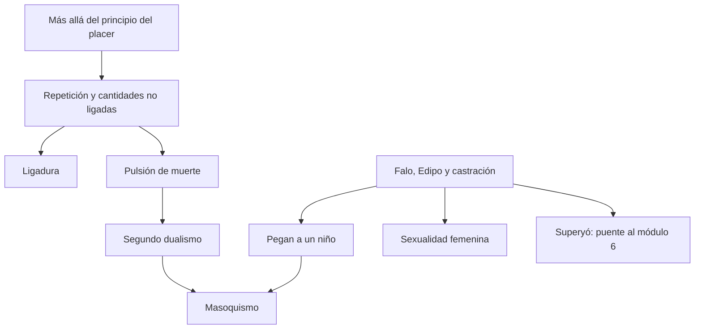

# Módulo 5 — ruptura del principio del placer, Edipo y sexualidad femenina

## Problema del módulo

El módulo parte de fenómenos que no se dejan explicar por la hegemonía del principio del placer ni solamente por el retorno de representaciones reprimidas. A partir de allí introduce lo no ligado, la compulsión de repetición y el segundo dualismo pulsional. En paralelo, Seminarios reconstruye las condiciones, recorridos y consecuencias del complejo de Edipo y del complejo de castración.

## Teóricos

### *Más allá del principio de placer*

- Fuentes de displacer que todavía no contradicen el principio del placer.
- Tres referentes: sueños traumáticos, fort-da y repetición en transferencia.
- Diferencia entre repetición de lo reprimido (*agieren*) y compulsión de repetición de aquello que nunca produjo placer.
- Protección antiestímulo, ruptura traumática y cantidades no ligadas.
- La ligadura como tarea previa a la tramitación por el principio del placer.
- Pulsión de muerte y segundo dualismo pulsional.

### Segundo dualismo y masoquismo

- Eros reúne, liga y complejiza; la pulsión de muerte tiende a desligar y reconducir a un estado anterior.
- Vida y muerte no aparecen puras: importan su mezcla, desmezcla y trasposición.
- Masoquismo erógeno primario, masoquismo femenino y masoquismo moral.
- El masoquismo erógeno primario como resto y testimonio de la mezcla pulsional.

## Prácticos

- Lectura detallada de los capítulos I a VI de *Más allá*.
- Energía libre y ligada; procesos primario y secundario.
- Sueño traumático como intento fallido de ligadura.
- Juego completo e incompleto del fort-da.
- Proyección de estímulos internos y preparación angustiada.
- Tres formas de masoquismo y primariedad del masoquismo.
- Articulaciones con la teoría del sueño, el principio de constancia y el narcisismo.

## Seminarios

### Condiciones del Edipo

- Ley del padre y obediencia retrospectiva en *Tótem y tabú*.
- Identificación primaria, anterior a la elección de objeto.
- Madre como primer objeto de amor y primera seductora.
- Castración materna y organización fálica.

### Falo, Edipo y castración

- La diferencia anatómica no produce por sí sola una inscripción psíquica de la diferencia sexual.
- La organización genital infantil se estructura alrededor del falo, no de un par pene/vagina.
- El falo no es el órgano: es el referente con el que se ordenan tener, falta y castración.
- En el varón, la amenaza de castración conduce al sepultamiento del Edipo.
- En la niña, el complejo de castración funciona como punto de viraje y vía de entrada al Edipo.

### Fantasía y sexualidad femenina

- Fantasías primordiales, fijación y formación de síntoma.
- “Pegan a un niño” como cicatriz del Edipo y fantasía fundamental.
- Tres fases de la fantasía y construcción analítica de la segunda.
- Fase preedípica, cambio de objeto y cambio de zona en el recorrido femenino.
- Complejo de masculinidad, inhibición/neurosis y vía hacia la feminidad como tres orientaciones freudianas.

## Articulaciones internas

- La pulsión de muerte permite leer el masoquismo; el masoquismo permite leer la fantasía de castigo y la resistencia del superyó.
- El sepultamiento del Edipo deja dos marcas privilegiadas por la cursada: superyó y “Pegan a un niño”.
- La castración enlaza Edipo, defensa y tercera teoría de la angustia.
- La compulsión de repetición prepara el pasaje desde el límite del recuerdo hacia resistencias que no se resuelven únicamente mediante interpretación.

> **Puente al módulo 6.** Lo no ligado deberá encontrar un lugar en el aparato; el masoquismo y el sepultamiento del Edipo deberán explicar la crueldad del superyó; la castración reaparecerá como condición de peligro.

## Alta probabilidad de evaluación

- Explicar por qué los tres referentes cuestionan la hegemonía del principio del placer.
- Diferenciar repetición y compulsión de repetición.
- Explicar trauma, ruptura de la protección antiestímulo y ligadura.
- Reconstruir el pasaje al segundo dualismo.
- Diferenciar las tres formas de masoquismo.
- Articular fase fálica, castración y asimetría edípica.
- Desarrollar las tres fases de “Pegan a un niño”.
- Reconstruir el recorrido freudiano de la sexualidad femenina.
