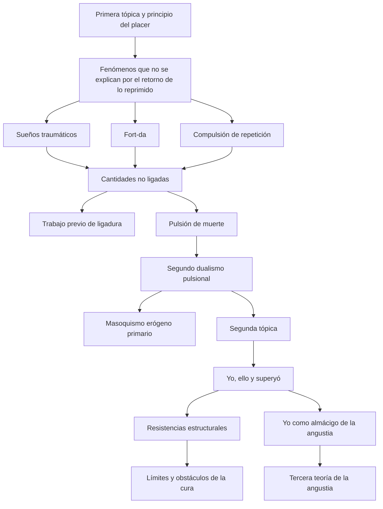
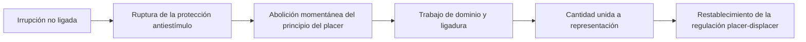

# De la ruptura del principio del placer a los límites de la cura

## El problema que organiza el tercer parcial

El tercer parcial no agrega simplemente una nueva lista de conceptos a la teoría anterior. Estudia un cambio de problema. La primera tópica, la represión y el retorno de lo reprimido permitían explicar sueños, síntomas, actos fallidos y transferencia. Pero Freud encuentra fenómenos que no se dejan ordenar enteramente como retorno de representaciones reprimidas ni como cumplimiento de deseo.

Los sueños traumáticos repiten una escena que despierta con terror. El niño reitera en el juego el momento displacentero de la partida. En transferencia, algunas experiencias no retornan como recuerdos sino como actos. La reacción terapéutica negativa muestra, además, que un paciente puede empeorar ante una mejoría y sostener una satisfacción en el padecimiento.

> **Tesis del recorrido.** El tercer parcial estudia cómo Freud amplía su teoría para incluir una dimensión pulsional no ligada que excede el campo de las representaciones. Esta ampliación transforma el dualismo pulsional, el aparato psíquico, la teoría de la angustia y la concepción de los obstáculos en la cura.

## El mapa general

El mapa no representa una cronología lineal. Muestra una serie de exigencias teóricas. La \concept{segunda tópica} no invalida la primera: intenta formalizar procesos que la oposición consciente-inconsciente ya no alcanza a explicar. Del mismo modo, el \concept{principio del placer} no desaparece cuando Freud postula un más allá; pierde su hegemonía.

## Primer movimiento: localizar un exterior al campo de las representaciones

Hasta aquí, el conflicto podía reconstruirse como oposición entre el yo y una representación reprimida que procuraba retornar. El síntoma producía displacer para el yo, pero alojaba una satisfacción pulsional sustitutiva. Seguía siendo posible situarlo dentro de la regulación placer-displacer.

En *Más allá del principio de placer*, Freud interroga una dimensión distinta. Las notas de clase la formulan como un *exterior pulsional*: cantidades que todavía no están ligadas a representaciones y que, por eso, no pueden tramitarse según la legalidad ya conocida.

> **Distinción decisiva.** Lo que está más allá del principio del placer no es simplemente algo muy displacentero. Es aquello cuya insistencia no puede explicarse todavía como placer para un sistema y displacer para otro.

Esta distinción evita un error frecuente. No toda repetición es compulsión de repetición; no todo displacer prueba la existencia de un más allá.

## Segundo movimiento: ligar antes de tramitar

El principio del placer regula cantidades ya incluidas en un circuito psíquico. Cuando una excitación perfora la protección antiestímulo, esa regulación queda transitoriamente abolida. El aparato debe realizar primero otro trabajo: dominar la cantidad y producir una ligadura.

Las clases denominan a este trabajo previo \concept{genuina actividad del aparato psíquico}. No equivale todavía a descargar o elaborar una representación: crea las condiciones para que algo pueda ser tramitado.

## Tercer movimiento: construir el segundo dualismo

La pulsión de muerte no debe imaginarse como una voluntad consciente de morir ni como una fuerza moralmente mala. Nombra una modalidad pulsional conservadora, repetitiva y desligante. Su contraposición con Eros reorganiza la teoría:

| Primer dualismo | Reordenamiento narcisista | Segundo dualismo |
|---|---|---|
| Autoconservación —también llamadas “yoicas” en la terminología temprana— / pulsiones sexuales | Dos destinos de la libido sexual: libido yoica / libido de objeto | Pulsiones de vida / pulsiones de muerte |

“Pulsiones yoicas” no debe confundirse con “libido yoica”: el primer término era otro nombre para las pulsiones de autoconservación; el segundo designa libido sexual investida en el yo. El narcisismo mostró precisamente que el yo también podía ser objeto de la libido. Por eso la oposición temprana entre autoconservación y sexualidad ya no podía sostenerse como dualismo fundamental. Freud reúne la libido yoica y la libido de objeto bajo Eros y sitúa frente a ellas la pulsión de muerte.

Pero vida y muerte no aparecen clínicamente en estado puro. Se presentan mezcladas en proporciones variables. El problema deja de ser solamente qué pulsión actúa y pasa a incluir cómo se mezclan, se desmezclan y encuentran destinos.

## Cuarto movimiento: incluir lo no reprimido en el aparato

La primera tópica distinguía consciente, preconsciente e inconsciente. Esa oposición sigue siendo válida, pero resulta insuficiente cuando Freud localiza resistencias inconscientes en el propio yo.

Si lo reprimido procura retornar, la fuerza que resiste no puede provenir simplemente de lo reprimido. El yo que reprime y resiste posee aspectos inconscientes. Surge así un tercer uso del término: un \concept{inconsciente estructural}, no reprimido.

> **Fórmula central.** Todo lo reprimido es inconsciente, pero no todo lo inconsciente es reprimido.

La segunda tópica —yo, ello y superyó— permite inscribir esta heterogeneidad. El yo no coincide con la conciencia; el ello no coincide con el conjunto de las representaciones reprimidas; el superyó puede ejercer una crueldad inconsciente y hallar satisfacción en el padecimiento.

## Quinto movimiento: de interpretar lo reprimido a trabajar obstáculos estructurales

La interpretación conserva su importancia, pero deja de presentarse como una herramienta suficiente. Algunas resistencias no ceden al reconstruir el sentido reprimido de un síntoma.

La reacción terapéutica negativa, la necesidad de castigo, la intensidad pulsional, la alteración del yo y la resistencia del ello obligan a revisar la teoría de la cura. El problema ya no es sólo *qué representación no puede devenir consciente*, sino también *qué satisfacción se sostiene en el obstáculo mismo*.

Esta zona permanecerá abierta hasta incorporar las próximas clases sobre *Inhibición, síntoma y angustia*, *Análisis terminable e interminable* y *La escisión del yo en el proceso defensivo*.

## Sexto movimiento: la angustia cambia de lugar

En la segunda teoría, la serie podía formularse como exigencia pulsional, represión y desarrollo de angustia. En 1926 Freud invierte la relación: la angustia señal producida por el yo pone en marcha la defensa.

Las notas de Seminarios ya permiten formular el punto de partida: el yo es el genuino almácigo de la angustia, la castración funciona como situación de peligro y el síntoma intenta evitar un desarrollo traumático. Falta todavía completar la serie entre nacimiento, desvalimiento, pérdida del objeto, angustia automática y angustia señal.

## Cómo leer los capítulos siguientes

Cada capítulo debe reconstruir cuatro operaciones:

1. qué fenómeno produce una dificultad;
2. qué distinción introduce Freud para pensarlo;
3. qué parte de la teoría anterior se conserva y cuál se modifica;
4. qué consecuencia tiene el cambio para la clínica y la cura.

El hilo conductor no será “qué dice cada texto” por separado, sino cómo cada texto responde al problema abierto por el anterior.
