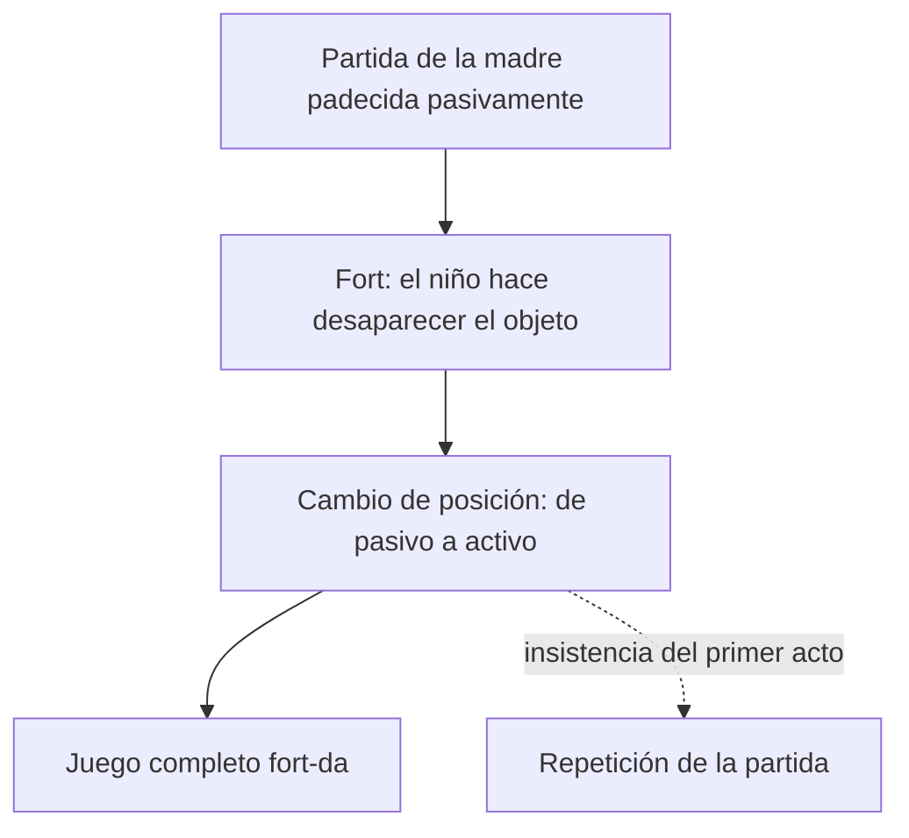
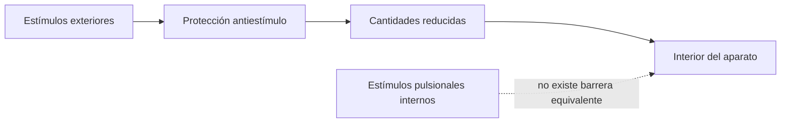

# Repetición, trauma y ligadura

## Por qué el displacer no alcanza

*Más allá del principio de placer* comienza examinando si el curso de los procesos psíquicos está regulado por el principio del placer. Freud no abandona de inmediato esa tesis. Primero distingue fuentes de displacer compatibles con ella.

El principio de realidad posterga una satisfacción, pero no renuncia a ella. La represión produce un placer que no puede ser sentido como tal por el yo: satisfacción para una moción pulsional, displacer para otro sistema. En ambos casos continúa operando la regulación placer-displacer.

> **Distinción decisiva.** Un fenómeno no está “más allá” sólo porque resulte doloroso. Debe mostrar una insistencia que no pueda reconducirse a una satisfacción regulada por el principio del placer.

Esta precisión prepara los tres referentes clínicos: sueños traumáticos, juego infantil y repetición en transferencia.

## Tres fenómenos, tres preguntas

| Fenómeno | Dificultad | Pregunta que abre |
|---|---|---|
| Sueño traumático | Repite la escena y despierta con terror | ¿Cómo puede el sueño no cumplir su función de guardián del dormir? |
| Fort-da | Reitera especialmente la partida displacentera | ¿Puede existir una ganancia independiente del principio del placer? |
| Repetición en transferencia | Actúa lo que no recuerda | ¿Toda repetición es retorno de una representación reprimida? |

Los fenómenos no son intercambiables. Cada uno vuelve visible un aspecto de la relación entre repetición, pulsión y ligadura.

## Sueños traumáticos

### Terror, angustia y miedo

Las clases subrayan tres diferencias:

| Afecto | Preparación | Objeto |
|---|---|---|
| Terror | Falta preparación; domina la sorpresa | Puede no estar determinado |
| Angustia | Hay expectativa o apronte frente al peligro | No requiere un objeto determinado |
| Miedo | Hay preparación | Se dirige a un objeto determinado |

La neurosis traumática requiere una situación sorpresiva y una irrupción para la cual el aparato no estaba preparado. El sueño devuelve al enfermo a la situación traumática y produce un despertar con terror.

Esto contradice la fórmula simple del sueño como cumplimiento de deseo. Las notas distinguen dos niveles de la revisión:

1. la función del sueño está alterada;
2. la repetición intenta producir retrospectivamente una ligadura que faltó en el momento del trauma.

> **Definición de trabajo.** El sueño traumático no repite principalmente por el contenido de la escena, sino como intento fallido y reiterado de ligar una excitación que irrumpió sin preparación.

La revisión no elimina toda relación entre sueño y deseo. Obliga a reconocer una función más originaria, previa a la regulación por el principio del placer.

## Fort-da: juego completo y repetición de la partida

Freud observa que el niño arroja un objeto y acompaña su desaparición con un sonido: *fort*. En el juego completo, el objeto vuelve: *da*.

Si se considera la secuencia completa, puede reconocerse una ganancia de placer. El niño convierte una experiencia pasiva —la partida de la madre— en una acción que él mismo dirige. Se apodera de la situación y escenifica partida y regreso.

La **ganancia directa de placer** se localiza con claridad en el segundo acto, el *da*: el objeto reaparece y el niño recibe con alegría su retorno. Esa satisfacción permite comprender el juego completo bajo el principio del placer. Sin embargo, el niño repite con mayor frecuencia y también de manera autónoma el primer acto, la desaparición. Esa insistencia impide reducir todo el juego a la alegría del retorno.

Las notas proponen dos puntuaciones complementarias:

- si se acentúa el juego completo, hay dominio de la experiencia y ganancia de placer;
- si se acentúa la repetición del *fort*, aparece una insistencia que no se explica por el placer del regreso.

> **Pregunta que apareció en 2025.** ¿En qué instancia del juego hay una ganancia directa de placer? En el *da*, cuando el objeto vuelve. El problema que abre *Más allá* no es negar esa ganancia, sino explicar la repetición autónoma y más frecuente del *fort*.

El segundo juego, frente al espejo, desplaza además la escena: ahora es el propio niño quien aparece y desaparece. La repetición participa de una separación respecto de la madre y de una posición más activa del sujeto.

## Repetición en transferencia: dos modalidades

El segundo parcial había presentado el *agieren*: el paciente no recuerda solamente, sino que actúa en la transferencia fragmentos de su vida infantil. Esa repetición puede pensarse como retorno de lo reprimido y como una forma de recordar en acto.

El tercer parcial introduce una separación que las notas consideran decisiva.

### Repetición como *agieren*

- retorna un fragmento reprimido de la vida sexual infantil;
- aquello que fue satisfacción puede producir displacer al yo;
- se inscribe en el conflicto entre yo y reprimido;
- conserva relación con el principio del placer.

### Compulsión de repetición

- insiste algo que no contiene posibilidad de placer para ningún sistema;
- no equivale al retorno de una representación reprimida;
- repite también fracasos y experiencias que nunca fueron placenteras;
- muestra una operatoria más originaria que la regulación placer-displacer.

> **Distinción decisiva.** No toda repetición en transferencia es compulsión de repetición. El *agieren* puede ser retorno de lo reprimido; la compulsión señala la insistencia de una dimensión no ligada.

Esta diferencia debe sostenerse incluso cuando Freud utiliza la misma expresión de manera todavía oscilante en el capítulo III.

## El eterno retorno de lo igual

La compulsión no aparece únicamente dentro del análisis. Freud describe destinos que parecen repetirse: una persona ocupa una y otra vez la misma posición, encuentra el mismo desenlace o padece una secuencia que atribuye a su destino.

La fórmula “eterno retorno de lo igual” designa esa insistencia. Lo decisivo no es demostrar que cada escena sea idéntica, sino reconocer una regularidad que el sujeto no gobierna conscientemente y que no se explica por una búsqueda deliberada de placer.

## La vesícula y la protección antiestímulo

Para construir un modelo del trauma, Freud utiliza una analogía biológica. Imagina un organismo elemental cuya superficie se modifica por el contacto con el exterior. Esa capa funciona como protección antiestímulo: reduce la intensidad de las excitaciones externas para que puedan ser procesadas.

El aparato puede protegerse parcialmente frente al exterior, pero no dispone de una barrera equivalente frente a las excitaciones internas. Por eso puede proyectarlas y tratarlas como si vinieran de afuera.

Las notas formulan esta paradoja como un *exterior en el interior*: una exigencia pertenece al aparato, pero se comporta como extranjera porque no está ligada al campo de las representaciones.

## Excitación traumática

Una excitación deviene traumática cuando perfora la protección antiestímulo. No se trata sólo de la intensidad de un acontecimiento narrable, sino de una cantidad que irrumpe sin preparación suficiente.

La ausencia de preparación diferencia el trauma del peligro anticipado. El \concept{apronte angustiado} funciona como última defensa: moviliza investiduras para recibir la excitación. Cuando falta o resulta insuficiente, domina el terror.

## Ligar antes de descargar

El principio del placer sólo puede operar sobre cantidades ligadas. Por eso, ante la irrupción traumática, la primera tarea no es descargar sino dominar y ligar.

> **Fórmula de la cátedra.** La \concept{genuina actividad del aparato psíquico} consiste en producir ligadura allí donde irrumpió una cantidad no ligada; sólo después puede restablecerse el principio del placer.

La repetición puede cumplir entonces una función paradójica. Es testimonio de la falla de ligadura, pero también un intento de producirla. Los sueños traumáticos repiten porque el trabajo no logra completarse de una vez.

## El resto

Las notas insisten en una regla de lectura: *en toda operación queda un resto*. La ligadura nunca es completa. Algo persiste como cantidad no ligada y vuelve a exigir trabajo.

Este resto no es una cosa localizable ni una representación escondida. Nombra un límite de la operación que incluye una exigencia pulsional en el campo psíquico.

El paso siguiente de Freud será designar esa insistencia mediante el concepto de \concept{pulsión de muerte}. El problema ya no será sólo cómo retorna una representación reprimida, sino cómo se articula la vida psíquica con una tendencia que desliga y repite.

## Qué conviene poder responder

Una respuesta sobre repetición, trauma y ligadura debería:

1. explicar por qué no todo displacer está más allá del principio del placer;
2. diferenciar sueños traumáticos, fort-da y repetición en transferencia;
3. separar *agieren* y compulsión de repetición;
4. definir terror por la falta de preparación;
5. explicar protección antiestímulo y excitación traumática;
6. justificar por qué la ligadura es anterior a la regulación por el principio del placer;
7. articular repetición, intento de ligadura y resto.
