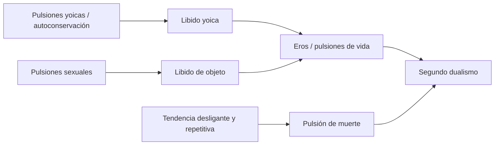
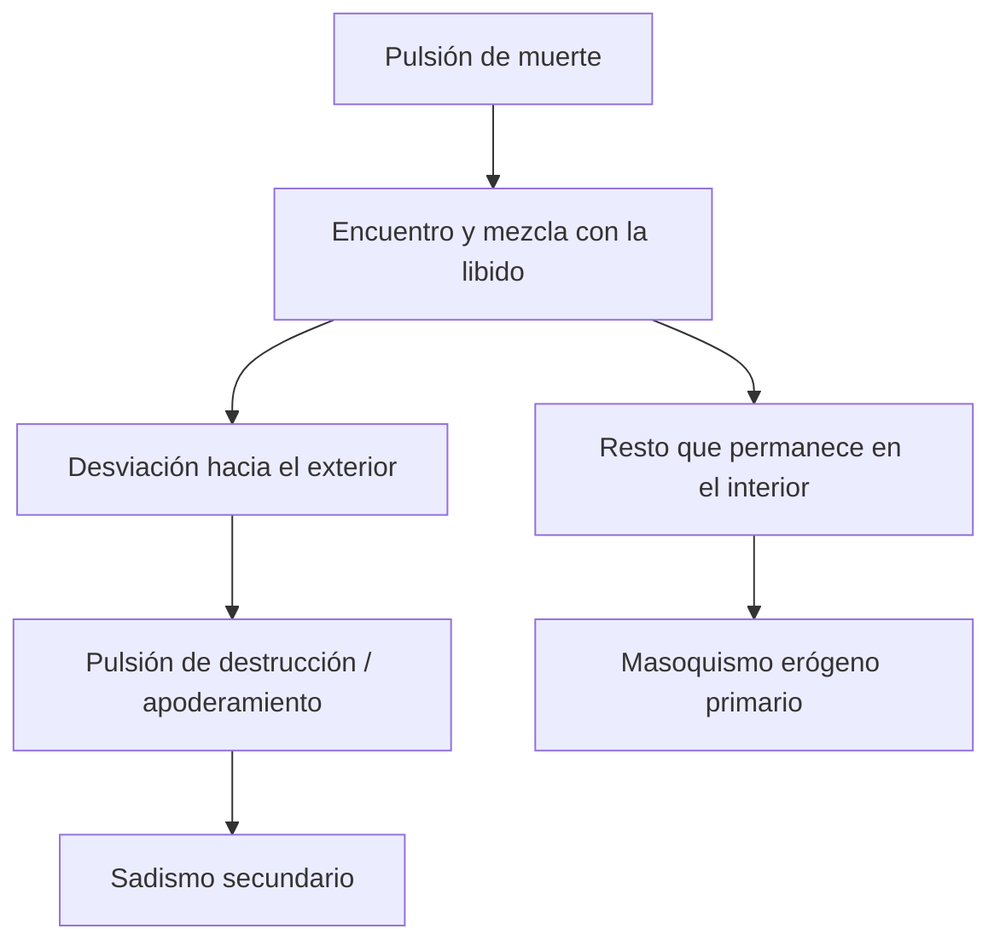

# Segundo dualismo pulsional y masoquismo

## Por qué el primer dualismo deja de alcanzar

El primer dualismo oponía pulsiones de autoconservación o yoicas y pulsiones sexuales. La introducción del narcisismo volvió inestable esa oposición: el yo también puede ser investido libidinalmente y funcionar como objeto.

La distinción entre libido yoica y libido de objeto describe desplazamientos de la libido, pero no constituye un dualismo entre fuerzas de naturaleza diferente. Ambas son libidinosas.

> **Distinción decisiva.** Libido yoica y libido de objeto son dos localizaciones de la libido, no dos clases fundamentales de pulsión.

El segundo dualismo opone \concept{pulsiones de vida} y \concept{pulsiones de muerte}. Eros liga, reúne y produce unidades cada vez mayores. La pulsión de muerte desliga, desagrega e insiste más allá del principio del placer.

## Una pulsión conservadora

Freud propone que toda pulsión es conservadora: tiende a restablecer un estado anterior. La afirmación resulta extraña si se identifica pulsión con desarrollo o búsqueda de novedad.

La vida se vuelve así un rodeo. Las pulsiones de vida complejizan y mantienen unidades; la pulsión de muerte empuja hacia una reducción más radical de tensiones. Pero este esquema no debe traducirse inmediatamente en conductas observables ni en intenciones conscientes.

> **Definición de trabajo.** La pulsión de muerte designa una tendencia conservadora, repetitiva y desligante que no se reduce al odio, la agresión consciente ni el deseo de morir.

## Pulsión de muerte y principio de placer

Las notas relacionan tres principios:

| Principio | Tendencia | Aclaración |
|---|---|---|
| Principio de nirvana | Reducción radical de la excitación | Freud lo vincula con la pulsión de muerte |
| Principio del placer | Regulación cualitativa de placer y displacer | Modifica el nirvana bajo la acción de la libido |
| Principio de realidad | Rodeo, demora y consideración del mundo | No elimina el principio del placer |

Freud había aproximado principio de placer y principio de nirvana. *El problema económico del masoquismo* obliga a diferenciarlos: existen aumentos de tensión placenteros y disminuciones displacenteras. Placer y displacer no dependen mecánicamente de una suma cuantitativa.

## Mezcla pulsional

Vida y muerte no se presentan normalmente aisladas. Las pulsiones aparecen mezcladas en proporciones variables. La libido intenta volver inocua la pulsión de muerte, en parte desviándola hacia el exterior.

Cuando se dirige hacia objetos, esa fuerza puede aparecer como apoderamiento, dominio, agresión o destrucción. El término \concept{sadismo} no designa aquí únicamente una perversión sexual: nombra también un destino exteriorizado de la pulsión destructiva.

La mezcla nunca es completa. Un resto permanece en el interior. Ese residuo permite a Freud postular un masoquismo originario, anterior al retorno del sadismo sobre la propia persona.

## El giro del masoquismo

En la teoría anterior, el sadismo era primario: una pulsión dirigida hacia afuera podía volverse contra la propia persona y producir masoquismo secundario.

El segundo dualismo invierte esa prioridad. Si una parte de la pulsión de muerte permanece desde el comienzo en el interior ligada por la libido, existe un \concept{masoquismo erógeno primario}.

> **Tesis central.** El masoquismo erógeno primario es el resto interior de pulsión de muerte que no fue trasladado hacia los objetos y quedó ligado libidinalmente.

No se trata de una conducta observable por sí misma. Es un supuesto estructural que fundamenta otras formas de masoquismo.

## Tres formas de masoquismo

### Masoquismo erógeno primario

- es constitutivo;
- permanece como residuo interior;
- testimonia la mezcla entre libido y pulsión de muerte;
- acompaña las fases del desarrollo libidinal;
- funciona como fundamento de las otras formas.

### Masoquismo femenino

Freud reúne fantasías en las que la persona es colocada en una posición pasiva, infantil, castigada o sometida. La denominación pertenece a su teoría y no debe confundirse con una descripción universal de las mujeres.

Las notas lo articulan con *Pegan a un niño*: la fantasía enlaza pasividad, castigo, culpa y satisfacción sexual. La posición masoquista puede expresar regresivamente “ser amado por el padre” bajo la forma “ser pegado por el padre”.

### Masoquismo moral

El masoquismo moral se aleja de una escenificación sexual manifiesta. La satisfacción se localiza en el padecimiento, el fracaso, la culpa y la necesidad de castigo.

Su importancia clínica aparece en la \concept{reacción terapéutica negativa}: cuando la cura progresa, el paciente empeora o se aferra a la enfermedad. El padecimiento posee un valor para una tendencia masoquista y para la severidad del superyó.

| Forma | Núcleo | Manifestación principal |
|---|---|---|
| Erógeno primario | Resto interior ligado libidinalmente | Fundamento no observable directamente |
| Femenino | Fantasías de pasividad, castigo y sometimiento | Escenas fantaseadas y satisfacción sexual |
| Moral | Necesidad de castigo y satisfacción en padecer | Conducta vital, culpa y resistencia a la cura |

## De la culpa a la resistencia

El masoquismo moral permite pasar del dualismo pulsional a la segunda tópica. Si el paciente sostiene una satisfacción en la enfermedad, no basta con interpretar la representación reprimida que produjo el síntoma.

El \concept{superyó} puede volverse hipermoral y cruel. Exige renuncia, pero también puede ordenar gozar y castigar al yo. La necesidad de castigo se manifiesta como resistencia sin que el paciente la reconozca conscientemente como culpa.

> **Paradoja clínica.** Aquello que el yo vive como padecimiento puede constituir una satisfacción para una tendencia masoquista y para la relación entre yo y superyó.

Esta paradoja prepara el estudio de las resistencias estructurales: resistencia del ello, resistencia del superyó y alteraciones defensivas del yo.

## Mezcla y desmezcla

La \concept{desmezcla pulsional} libera componentes destructivos antes ligados por Eros. Las notas vinculan este problema con la crueldad del superyó, la melancolía y ciertos rasgos de la neurosis obsesiva.

No debe pensarse la mezcla como una combinación estable de dos sustancias. Es una relación dinámica: Eros puede ligar, desviar y organizar; la desmezcla puede aumentar la acción muda de la pulsión de muerte.

La pulsión de vida hace “alboroto” porque sus investiduras y objetos resultan más visibles. La pulsión de muerte trabaja de manera muda: se infiere por sus efectos, por la repetición, la desligadura, la destrucción o la satisfacción en el padecimiento.

## Qué conviene poder responder

Una respuesta sobre segundo dualismo y masoquismo debería:

1. explicar por qué el narcisismo vuelve insuficiente el primer dualismo;
2. distinguir libido yoica y libido de objeto de un verdadero dualismo pulsional;
3. definir Eros y pulsión de muerte sin moralizarlos;
4. explicar mezcla, exteriorización y resto interior;
5. justificar la primariedad del masoquismo erógeno;
6. diferenciar las tres formas de masoquismo;
7. articular masoquismo moral, culpa, superyó y reacción terapéutica negativa.
