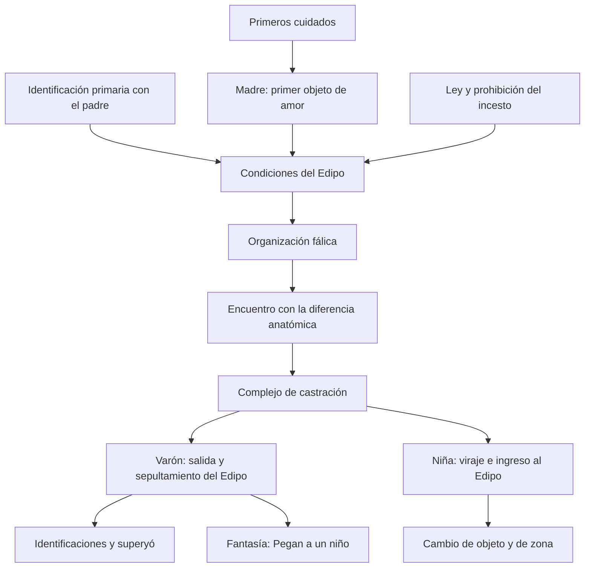
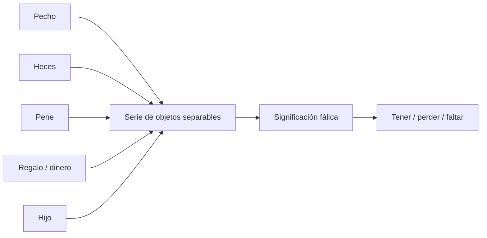
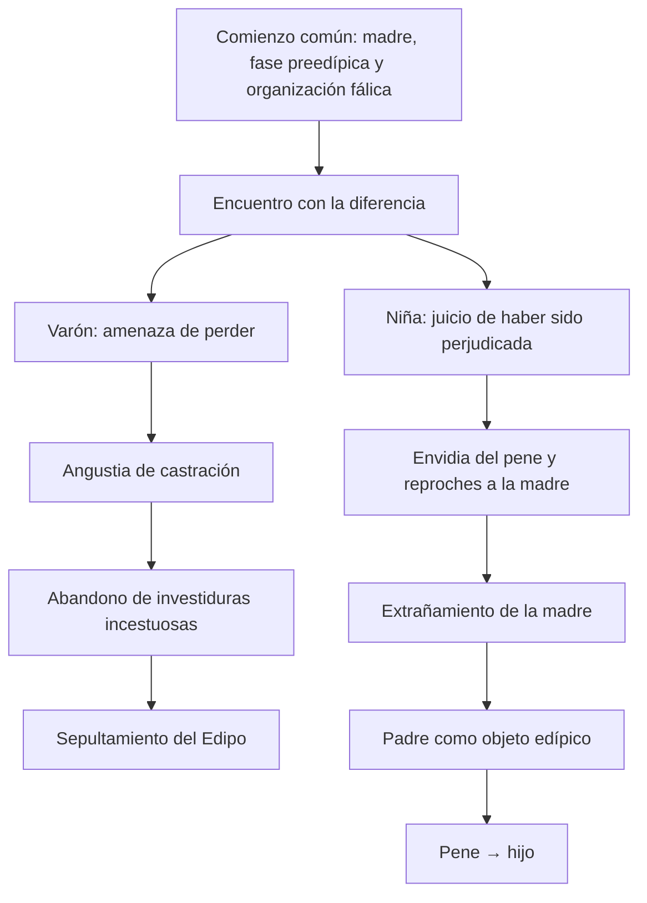
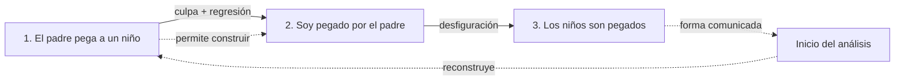

# Edipo, castración y sexualidad femenina

## El recorrido de un vistazo

El diagrama reúne relaciones lógicas, no una cronología biológica universal. El comienzo es común, pero la función del complejo de castración produce recorridos asimétricos.

> **Tesis del capítulo.** El complejo de castración no tiene el mismo efecto para ambos recorridos: en el varón impulsa la salida del Edipo; en la niña funciona como punto de viraje que posibilita su entrada.

## Una diferencia que la anatomía no resuelve

Para Freud, la diferencia anatómica no se traduce de manera directa ni completa en diferencia psíquica. La sexualidad infantil es pulsional, se constituye en relación con otros y atraviesa una organización fálica. La pregunta no es simplemente qué órgano posee cada cuerpo, sino cómo se inscriben tener, falta, deseo y prohibición.

Esta reconstrucción presenta la teoría freudiana y la lectura de la cátedra. Sus categorías históricas no deben confundirse con una descripción biológica ni con una teoría contemporánea de las identidades de género.

## Organización genital infantil

Después de las organizaciones oral y sádico-anal, Freud postula una organización genital infantil. Su particularidad es que no hay todavía primado de los genitales en plural, sino primado del falo. La premisa infantil es que todos poseen pene; cuando aparece una diferencia, se la interpreta con la oposición fálico/castrado.

El falo no equivale al pene. Es un referente privilegiado que permite organizar una serie de objetos valiosos, separables o perdibles: pecho, heces, pene, regalos, dinero e hijo. La fase fálica resignifica retroactivamente pérdidas anteriores dentro de una ecuación simbólica.

La ecuación no vuelve idénticos esos objetos. Los relaciona porque pueden adquirir un valor fálico y entrar en una serie de separación, intercambio o pérdida.

## Condiciones del complejo de Edipo

La cursada destaca tres condiciones:

1. la ley del padre, reconstruida míticamente en *Tótem y tabú* mediante el parricidio y la obediencia retrospectiva;
2. la identificación primaria con el padre, anterior a toda elección de objeto;
3. la castración en la madre, es decir, el reconocimiento de que el niño no completa enteramente su deseo.

La madre, como función de los primeros cuidados, es el primer objeto de amor y la primera seductora: introduce satisfacciones que exceden la necesidad. El padre aparece tempranamente como objeto de identificación. Sobre esa ligazón preedípica se organizarán luego investiduras amorosas y hostiles.

## El Edipo en el varón

En el llamado Edipo positivo, la madre es objeto de una investidura activa y el padre ocupa una posición rival, aunque ambivalente. En el negativo, el padre es objeto de una moción pasiva y la madre ocupa la posición rival. El complejo completo incluye las cuatro tendencias.

El encuentro con la diferencia anatómica vuelve eficaz la amenaza de castración. Para conservar el pene, el niño abandona las investiduras incestuosas. Freud describe el resultado ideal como sepultamiento y no como una mera represión: las investiduras de objeto se resignan y son sustituidas por identificaciones.

Quedan efectos duraderos:

- una corriente tierna hacia los objetos primarios;
- la formación del superyó;
- la fantasía fundamental “Pegan a un niño”;
- menosprecio de lo femenino y rechazo de la posición pasiva como posibles consecuencias neuróticas de la amenaza.

## La asimetría en un solo mapa

| Operación | Varón | Niña |
|---|---|---|
| Fase fálica y Edipo | contemporáneos | la fase preedípica conserva mayor peso |
| Castración | amenaza de una pérdida posible | lectura de un perjuicio ya ocurrido |
| Efecto sobre el Edipo | favorece la salida | favorece la entrada |
| Cambio de objeto | conserva a la madre hasta el sepultamiento | pasa de la madre al padre |
| Salida | amenaza de castración | menos determinada; Freud menciona la desilusión |

## El Edipo en la niña: la asimetría

El comienzo es común: la madre es el primer objeto de amor y la satisfacción fálica se organiza en torno del clítoris. Pero el complejo de castración cumple una función opuesta. Mientras en el varón contribuye a la salida del Edipo, en la niña opera como punto de viraje que posibilita su entrada.

La niña interpreta la diferencia como un perjuicio: no recibió aquello que esperaba. De allí surgen la envidia del pene, la herida narcisista y los reproches a la madre. Esos motivos erosionan la ligazón preedípica, favorecen el extrañamiento respecto de la madre y el pasaje hacia el padre.

El recorrido supone dos desplazamientos:

- cambio de objeto: de la madre al padre;
- cambio de zona: abandono relativo de la satisfacción clitoriana en dirección a la vagina.

La ecuación pene-hijo permite sustituir el deseo de pene por el deseo de recibir un hijo del padre. El Edipo femenino es, por ello, una formación secundaria que hereda deseos y demandas de la ligazón preedípica. Freud deja menos determinada su salida: puede abandonarse por desilusión, pero no existe un equivalente simétrico de la amenaza de castración.

## Tres orientaciones freudianas

La 33.ª conferencia distingue tres orientaciones posibles, no etapas obligatorias:

1. complejo de masculinidad: rechazo persistente de la castración y conservación de la posición fálica;
2. inhibición sexual o neurosis: renuncia a la satisfacción y al amor materno, con posibles compensaciones narcisistas;
3. vía hacia la feminidad: entrada en el Edipo, elección del padre y sustitución pene-hijo.

La maternidad funciona en Freud como una solución posible frente a la falta fálica; no “resuelve” por sí misma la sexualidad ni agota las posiciones subjetivas.

## “Pegan a un niño”: una cicatriz del Edipo

La fantasía de paliza testimonia el pasaje por el Edipo y fija una modalidad de satisfacción. Tiene tres personajes: quien relata o mira, quien castiga y quien es castigado.

La flecha superior representa la transformación lógica de la fantasía. Las líneas punteadas muestran el recorrido inverso del análisis: se parte de la tercera fase, se reconstruye la primera y se construye la segunda.

### Primera fase: “El padre pega a un niño”

El niño castigado es un rival odiado. La significación reconstruida es: “el padre le pega porque me ama a mí”. No es todavía estrictamente sádica ni masoquista.

### Segunda fase: “Soy pegado por el padre”

Es la fase decisiva, inconsciente y construida en el análisis. La culpa por las mociones incestuosas provoca una regresión a la organización sádico-anal. Ser golpeado funciona como sustituto regresivo de ser amado por el padre: reúne castigo y satisfacción masoquista.

### Tercera fase: “Los niños son pegados”

Es la forma comunicada por el paciente. El agente se vuelve indeterminado, aparecen varios niños y el fantaseador ocupa el lugar de espectador. Aunque parece sádica, la satisfacción sigue siendo masoquista y se enlaza con la masturbación.

La secuencia del análisis no coincide con la cronología: suele partir de la tercera fase, recuperar la primera y construir la segunda. La fantasía fundamental no retorna como un recuerdo reprimido ordinario; permanece fija, monótona y eficaz en síntomas, carácter y vínculos.

> **Para recordar.** La segunda fase es la decisiva: “ser pegado” reúne el castigo por el amor incestuoso con un sustituto regresivo de “ser amado por el padre”.

## Dos articulaciones decisivas

### Con el segundo parcial

La fantasía permite pasar de la caída de la teoría de la seducción a la realidad psíquica. No importa sólo si una escena ocurrió materialmente: las fantasías primordiales encuadran la satisfacción pulsional y participan de la fijación que sostiene el síntoma.

### Con el módulo 6

El sepultamiento del Edipo produce identificaciones que intervienen en la génesis del superyó. A su vez, la castración será retomada como condición de peligro y motor de la defensa en la tercera teoría de la angustia.
