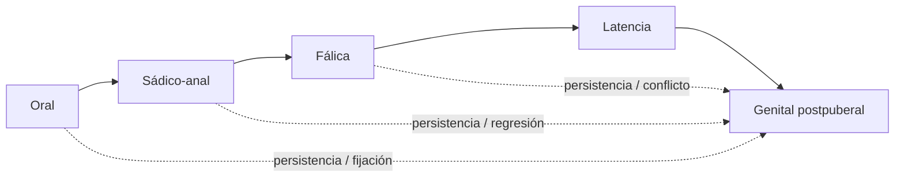
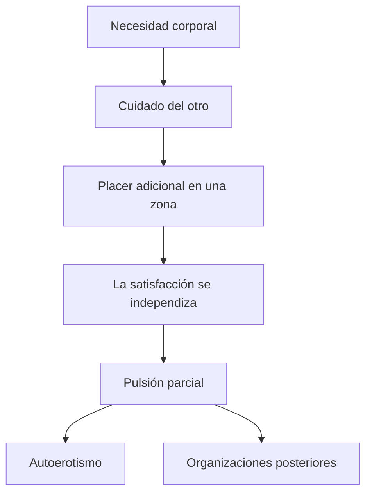
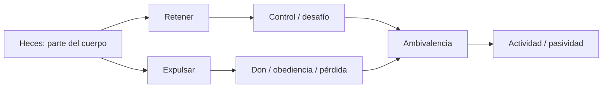
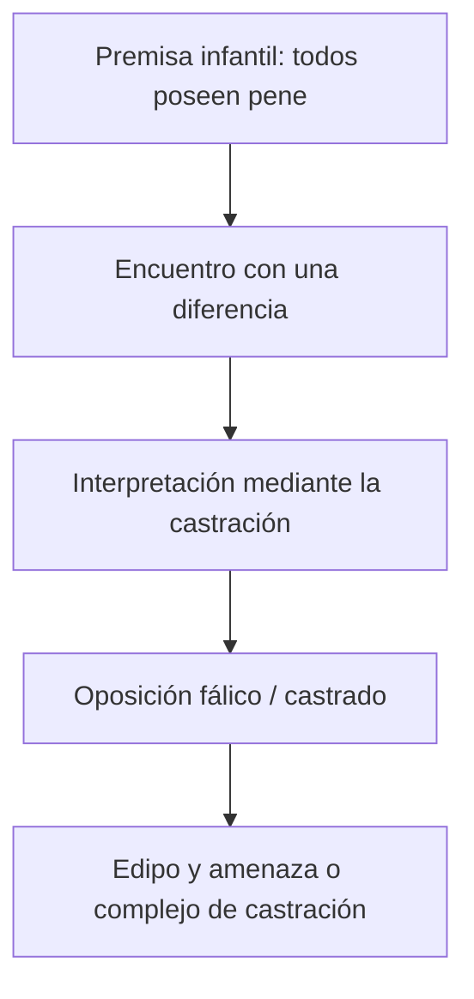
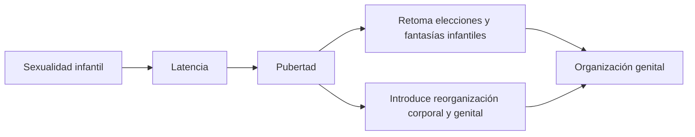
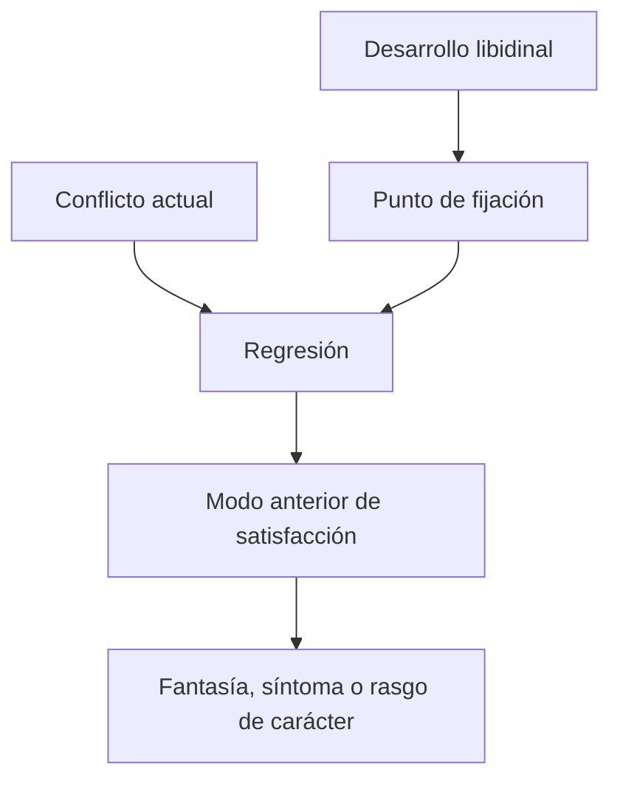

# Organizaciones del desarrollo sexual

## La idea central

Freud no presenta una escalera de etapas cerradas que se suceden y desaparecen. Reconstruye, en textos de distintas épocas, **organizaciones de la sexualidad**: momentos en los que una zona erógena, ciertas pulsiones parciales y un modo de relación con el objeto adquieren predominio.

La línea continua indica la secuencia lógica general. Las líneas punteadas recuerdan lo decisivo: una organización posterior **no borra** las anteriores. Sus modos de satisfacción pueden conservarse, combinarse, fijarse o convertirse en puntos de regresión.

> **Fórmula para el parcial.** Las fases son organizaciones predominantes de la libido, no edades rígidas ni adquisiciones que sustituyen por completo a las anteriores.

## El mapa completo

| Organización | Zona y operación predominantes | Relación con el objeto | Oposiciones y problemas | Conceptos que reaparecen en la cursada |
|---|---|---|---|---|
| **Oral o canibálica** | Boca: succionar, incorporar, morder | El objeto se obtiene inicialmente en la satisfacción de la necesidad; luego la satisfacción puede independizarse | Incorporar / ser incorporado; amar / devorar | apuntalamiento, autoerotismo, incorporación, identificación |
| **Sádico-anal** | Ano y musculatura: retener, expulsar, dominar | Las heces pueden valer como parte del cuerpo, regalo, desafío o instrumento de intercambio | Actividad / pasividad; dominio / sometimiento; amor / odio | ambivalencia, sadismo, obediencia, desafío, regresión |
| **Fálica** | Genitales bajo el primado del falo | Los objetos parentales quedan incluidos en la trama edípica | Fálico / castrado; tener / perder / faltar | premisa universal del pene, Edipo, castración, fantasía |
| **Latencia** | Inhibición y reorganización de las manifestaciones sexuales infantiles | Se amplían los destinos no directamente sexuales | Permitido / prohibido | represión, sublimación, vergüenza, asco, ideales |
| **Genital postpuberal** | Coordinación relativa de las pulsiones parciales bajo el primado genital | Elección de objeto fuera de los objetos infantiles | Masculino / femenino en la formulación freudiana | pubertad, elección de objeto, sexualidad en dos tiempos |

La tabla ordena predominancias. No significa que cada momento posea una única zona, una conducta exclusiva o una fecha universal de inicio y finalización.

## Antes de las organizaciones: pulsiones parciales y autoerotismo

El punto de partida no es un sujeto ya unificado que busca un objeto genital. La sexualidad infantil se presenta como una multiplicidad de **pulsiones parciales** apoyadas en distintas zonas erógenas. Cada una procura una satisfacción propia y, al comienzo, puede satisfacerse en el cuerpo sin dirigirse a una persona total: eso es el autoerotismo.

El chupeteo sirve como modelo: la boca interviene primero en la alimentación, pero luego puede procurar placer sin alimento. A esto Freud lo llama **apuntalamiento** de la sexualidad en una función de autoconservación. El desprendimiento posterior permite comprender por qué la sexualidad excede la necesidad biológica.

## Organización oral: incorporar

En la organización oral, la actividad sexual todavía no se separa claramente de la nutrición. La meta es la incorporación del objeto: tenerlo dentro, apropiárselo o destruirlo al devorarlo.

Tres conexiones son importantes:

- el pecho es simultáneamente fuente de alimento y ocasión de placer;
- la incorporación funciona como prototipo corporal de formas posteriores de identificación;
- amor y destrucción pueden coincidir: conservar al objeto dentro exige, fantasmáticamente, hacerlo desaparecer como objeto separado.

“Oral” no significa simplemente llevarse cosas a la boca. Designa una lógica de satisfacción que puede persistir y adquirir nuevas formas.

## Organización sádico-anal: retener, expulsar y dominar

La organización sádico-anal enlaza la zona anal con la pulsión de apoderamiento. Retener y expulsar no son meros hechos fisiológicos: pueden funcionar como obediencia, desafío, regalo, pérdida o ejercicio de control sobre quien demanda.

Aquí cobra fuerza la oposición **actividad/pasividad**, todavía no equivalente a masculino/femenino. La coexistencia de ternura y hostilidad hacia el mismo objeto permite hablar de ambivalencia.

Esta organización es especialmente importante para leer *Pegan a un niño*: la culpa por los deseos edípicos impulsa una regresión a lo sádico-anal, y “ser pegado” combina castigo, sometimiento y satisfacción masoquista.

## Organización fálica: una genitalidad todavía infantil

Freud la denomina también **organización genital infantil**, pero no debe confundirse con la genitalidad posterior a la pubertad. Existe un interés dominante por los genitales, aunque la diferencia sexual se ordena bajo el primado de un único término: el falo.

La oposición propia de esta fase es **fálico/castrado**, no todavía masculino/femenino. La vagina no adquiere el estatuto de un genital complementario equivalente. Por eso la fase fálica es simultáneamente genital e infantil.

El falo no es idéntico al órgano anatómico. Funciona como referente de una serie de objetos separables y valorados —pecho, heces, pene, regalo, dinero, hijo— que pueden significarse en términos de tener, perder, dar o faltar.

## Latencia: un intervalo de reorganización

La latencia no es una organización libidinal equivalente a oral, anal o fálica. Es un período en el que una parte de la sexualidad infantil sucumbe a la represión y se construyen diques como el asco, la vergüenza y las exigencias ideales. También se abren destinos como la sublimación.

No implica ausencia de sexualidad. Persisten satisfacciones, fantasías e investigaciones infantiles, aunque modificadas o menos visibles.

## Organización genital: una síntesis relativa

Con la pubertad se produce una reorganización: las pulsiones parciales quedan coordinadas de manera relativa bajo el primado de la zona genital y se consolida una elección de objeto. Freud habla de sexualidad **en dos tiempos** porque la pubertad no inaugura la sexualidad, sino que retoma y resignifica la sexualidad infantil después de la latencia.

La síntesis nunca es total. Las pulsiones parciales conservan satisfacciones propias y pueden integrarse como placer preliminar, permanecer autónomas o intervenir en síntomas y perversiones.

## Fijación y regresión: por qué las fases siguen importando

El desarrollo libidinal deja puntos de **fijación**: modos de satisfacción en los que queda retenida una inversión particularmente intensa. Ante un conflicto posterior puede producirse una **regresión**, es decir, el retorno a una organización, un objeto o un modo de satisfacción anterior.

| Concepto | Pregunta que responde | Ejemplo en este parcial |
|---|---|---|
| **Fijación** | ¿Dónde quedó especialmente investida la libido? | permanencia de una modalidad de satisfacción infantil |
| **Regresión** | ¿A qué modo anterior retorna frente al conflicto? | en *Pegan a un niño*, retorno de lo genital-edípico a lo sádico-anal |
| **Persistencia** | ¿Qué componente anterior continúa sin necesidad de una regresión? | placer oral, anal o de mirar integrado en la sexualidad adulta |

## Lo que no conviene responder

### “Cada fase corresponde a una edad exacta”

Freud propone una secuencia y reconoce momentos del desarrollo, pero no ofrece un calendario universal con fronteras clínicas rígidas. Para el parcial importa más la lógica de cada organización que memorizar edades.

### “La fase nueva elimina la anterior”

Las organizaciones se superponen y dejan restos. Sin persistencia, fijación y regresión no podrían explicarse las fantasías, los síntomas ni los rasgos de carácter.

### “Fálica y genital son sinónimos”

La fálica es una organización genital **infantil**, regida por la oposición fálico/castrado. La genital postpuberal supone una coordinación nueva de las pulsiones parciales y otra construcción de la diferencia sexual.

### “Oral, anal, fálica y genital forman una teoría presentada de una vez”

El esquema se construye retrospectivamente a partir de textos y revisiones de diferentes momentos. *Tres ensayos de teoría sexual* brinda la arquitectura de la sexualidad infantil y la pubertad; los desarrollos posteriores precisan la organización sádico-anal y agregan la organización genital infantil o fálica.

## Una respuesta breve de examen

> Freud denomina organizaciones pregenitales a configuraciones de la sexualidad en las que predominan determinadas zonas erógenas, metas pulsionales y relaciones con el objeto. En la organización oral predomina la incorporación; en la sádico-anal, la retención-expulsión y la oposición actividad/pasividad. La organización fálica introduce el primado del falo y la oposición fálico/castrado, por lo que constituye una genitalidad infantil articulada con Edipo y castración, distinta de la organización genital postpuberal. La sucesión no supone que cada fase desaparezca: las modalidades anteriores persisten, pueden constituir puntos de fijación y orientar regresiones ante conflictos posteriores.

## Textos que construyen el esquema

- *Tres ensayos de teoría sexual*: pulsiones parciales, apuntalamiento, autoerotismo, organizaciones pregenitales, latencia, pubertad y primado genital.
- *La predisposición a la neurosis obsesiva*: precisión de la organización sádico-anal y de la oposición actividad/pasividad.
- *La organización genital infantil*: introducción de la fase fálica y de la oposición fálico/castrado.
- *El sepultamiento del complejo de Edipo*, *Algunas consecuencias psíquicas de la diferencia anatómica entre los sexos* y la 33.ª conferencia: destinos de la organización fálica, Edipo y castración.

## Puente hacia el capítulo siguiente

La organización fálica aporta la gramática con la que el niño interpreta la diferencia anatómica. El complejo de castración transforma esa interpretación en una condición decisiva del Edipo. El próximo capítulo parte de allí para reconstruir los recorridos asimétricos que Freud atribuye al varón y a la niña.
