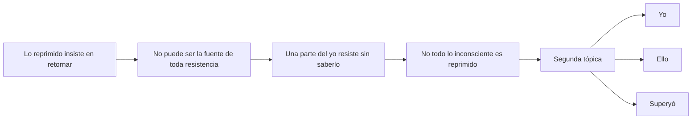
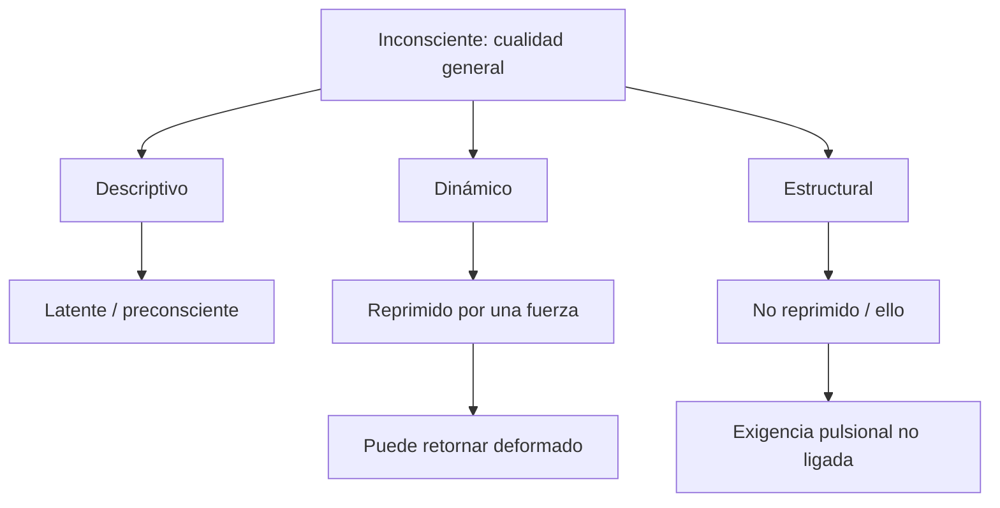
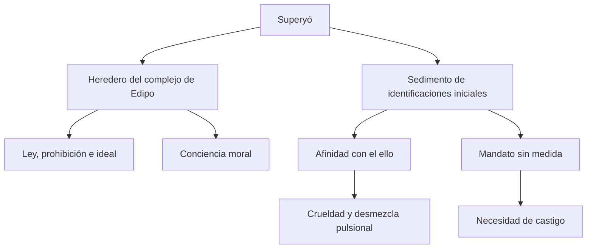
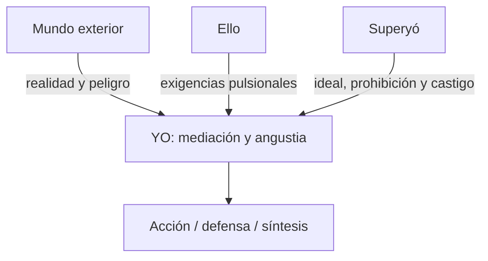

# Segunda tópica: yo, ello y superyó

## El problema en una imagen

> **Tesis del capítulo.** La segunda tópica no reemplaza la primera: construye otro mapa para localizar lo inconsciente no reprimido y las resistencias que no provienen del retorno de representaciones.

## Por qué la primera tópica no alcanza

La primera tópica distingue inconsciente, preconsciente y consciente. Es indispensable para explicar el deseo inconsciente, la represión y sus formaciones: sueño, síntoma, lapsus, chiste y transferencia. Sin embargo, aparece un problema clínico: la resistencia no puede provenir simplemente de lo reprimido, porque lo reprimido insiste en retornar. Una parte del yo resiste sin saberlo.

La oposición consciente/inconsciente tampoco coincide ya con la oposición yo/reprimido. Freud necesita incluir procesos inconscientes no reprimidos y satisfacciones que exceden el principio del placer. La segunda tópica no invalida a la primera: responde a otro problema y ambas deben articularse.

## Tres sentidos de “inconsciente”

| Sentido | ¿Fue reprimido? | ¿Cómo se hace visible? | Concepto asociado |
|---|---:|---|---|
| Descriptivo | No necesariamente | puede devenir consciente | Preconsciente |
| Dinámico | Sí | retorno en sueños, síntomas y transferencia | Reprimido |
| Estructural | No | compulsión, resistencia y efectos pulsionales | Ello |

### Descriptivo

Designa lo que en este momento no es consciente. Incluye contenidos latentes capaces de devenir conscientes con relativa facilidad; en términos sistemáticos, corresponde al preconsciente.

### Dinámico

Designa lo reprimido, mantenido fuera de la conciencia por una fuerza. Tiene representaciones-cosa y busca retornar mediante formaciones sustitutivas.

### Estructural o no reprimido

Designa una dimensión que no fue expulsada por la represión ni es meramente latente. Freud la formaliza como ello. Por eso: todo lo reprimido es inconsciente, pero no todo lo inconsciente es reprimido.

## El ello

El ello es lo otro psíquico en lo que el yo se continúa. Es primario: el yo se diferencia posteriormente a partir de él por el contacto con el mundo exterior. Es sede de las pulsiones, reservorio de libido y campo de procesos no ligados.

No debe pensarse como una bolsa que contiene exclusivamente lo reprimido. Lo reprimido confluye con el ello, pero el ello lo excede. Su fuerza puede actuar sin representación-palabra ni apropiación consciente por parte del yo.

## El yo

El yo es una parte del ello modificada por la influencia del mundo exterior. Media entre exigencias pulsionales, realidad y superyó; intenta reemplazar el principio de placer por el principio de realidad y gobierna la motilidad. Pero no posee una fuerza enteramente propia: toma prestada la energía del ello y muchas veces ejecuta sus exigencias como si fueran decisiones propias.

Freud lo caracteriza además como:

- proyección de una superficie corporal;
- ligado a percepción, representaciones-palabra y tarea de síntesis;
- parcialmente inconsciente;
- incapaz de separarse nítidamente del ello;
- genuino almácigo de la angustia.

Su unidad es una aspiración y no un dato garantizado. La función de síntesis puede fracasar; de allí la expresión de la guía “yo como ficción ideal”.

## El superyó

El superyó es una diferenciación dentro del yo que se le contrapone. La cátedra subraya dos vertientes de su génesis.

### Heredero del complejo de Edipo

Las investiduras de los objetos parentales resignadas son sustituidas por identificaciones. El superyó conserva el carácter del padre y la prohibición: ordena renuncias, sostiene ideales y participa de la conciencia moral. En esta vertiente funciona como instancia de ley.

### Sedimento de identificaciones iniciales

Las primeras identificaciones se producen cuando el yo todavía es endeble y dependiente. El superyó mantiene así una afinidad duradera con el ello y puede subrogarlo ante el yo. Su mandato no se limita a prohibir: también puede exigir una satisfacción imposible y sin medida.

Estas vertientes permiten comprender su paradoja: cuanto mayor es la renuncia pulsional, mayor puede ser su severidad. La ley no agota al superyó; hay una dimensión cruel o insensata vinculada con la pulsión de muerte.

La doble entrada evita reducir el superyó a “la voz buena de la ley”. Puede ordenar la renuncia y, al mismo tiempo, exigir una satisfacción imposible que castiga al yo.

## Conciencia moral y sentimiento inconsciente de culpa

La conciencia moral consciente se expresa como tensión entre el yo actual y el ideal. El sentimiento inconsciente de culpa es distinto: el paciente no necesariamente se siente culpable, sino enfermo. Se manifiesta clínicamente como necesidad de castigo y resistencia a la mejoría.

La denominación es paradójica porque Freud solía considerar conscientes a los sentimientos. Lo decisivo no es que el paciente experimente “culpa” como afecto reconocible, sino que una exigencia moral inconsciente produzca efectos y encuentre satisfacción en el padecimiento.

## Los tres vasallajes y las tres angustias

El yo sirve a tres amos:

| Amo o peligro | Exigencia | Angustia correspondiente |
|---|---|---|
| Mundo exterior | reconocer la realidad y evitar un peligro objetivo | angustia realista |
| Ello | tramitar exigencias pulsionales | angustia neurótica |
| Superyó | responder a ideales, prohibiciones y castigo | angustia de la conciencia moral |

La mediación no implica soberanía. El yo intenta conciliar demandas incompatibles y queda expuesto a ser avasallado por cualquiera de ellas.

## Articulación con el segundo dualismo

La segunda tópica inscribe en el aparato problemas abiertos por *Más allá del principio del placer*. El ello permite formalizar una dimensión pulsional no ligada; el yo conserva la tarea de ligar y sintetizar; el superyó muestra cómo la pulsión de muerte puede participar de una instancia moral.

Eros y pulsión de muerte aparecen mezclados. Cuando una desmezcla libera componentes destructivos, el superyó puede volverse hipercruel contra el yo. De allí el enlace entre superyó, masoquismo moral, necesidad de castigo y reacción terapéutica negativa.

## Fórmula de respuesta

Ante una consigna sobre segunda tópica conviene seguir este orden:

1. presentar el obstáculo clínico que exige la reformulación;
2. distinguir los tres sentidos de inconsciente;
3. caracterizar las relaciones, no sólo las definiciones aisladas, entre yo, ello y superyó;
4. mostrar un efecto clínico: resistencia, culpa inconsciente o reacción terapéutica negativa;
5. aclarar que la segunda tópica complementa y reordena a la primera.
