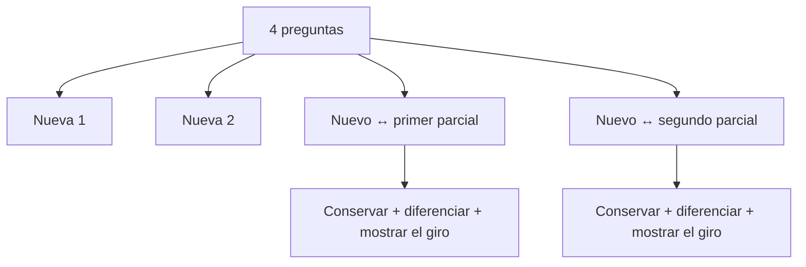
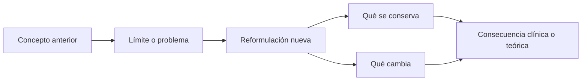
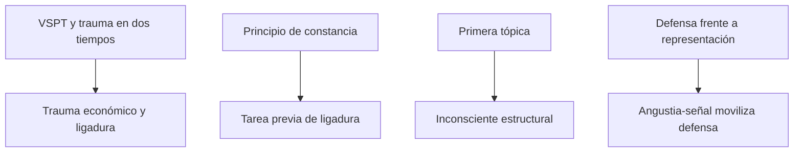
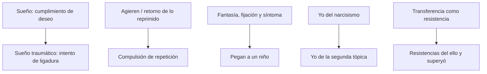

# Mapas de articulación acumulativa

## La arquitectura del parcial

La articulación no es un quinto tema. Es una operación que debe practicarse dentro de cada núcleo nuevo.

## Cómo se responde una consigna de articulación

Articular no es yuxtaponer dos resúmenes ni afirmar que dos conceptos son idénticos. Una buena respuesta debe:

1. definir brevemente cada término en su texto y momento teórico;
2. establecer el problema común;
3. precisar qué se conserva, qué cambia y qué concepto nuevo resulta necesario;
4. sostener la relación mediante un mecanismo, una escena o un efecto clínico;
5. cerrar retomando exactamente la consigna.

## Contenido nuevo ↔ primer parcial

### Trauma temprano ↔ trauma en *Más allá*

- Primer tramo: vivencia sexual prematura, defensa, recuerdo que adquiere eficacia retroactiva y trauma en dos tiempos.
- Tercer tramo: irrupción económica que perfora la protección antiestímulo y deja cantidades no ligadas.
- Relación: ambos explican un exceso que el aparato no domina, pero uno se organiza alrededor del recuerdo, el sentido y la defensa; el otro, alrededor de cantidad, sorpresa y ligadura.

### Principio de constancia ↔ ligadura

- Primer tramo: el aparato procura reducir o mantener constante la excitación.
- Tercer tramo: antes de descargar según placer/displacer, debe ligar la cantidad libre.
- Cambio: el principio del placer deja de ser la tarea más originaria del aparato.

### Primera tópica ↔ segunda tópica

- Primer tramo: inconsciente, preconsciente y consciente explican represión y retorno.
- Tercer tramo: yo, ello y superyó explican resistencias inconscientes no reducibles a lo reprimido.
- Relación: las tópicas se superponen y responden a problemas diferentes; la segunda no elimina a la primera.

### Defensa temprana ↔ angustia-señal

- Primer tramo: el yo se defiende de una representación inconciliable y separa representación y afecto.
- Tercer tramo: el yo anticipa un peligro mediante angustia-señal y pone en marcha la represión.
- Cambio: se invierte la relación causal entre angustia y represión.

## Contenido nuevo ↔ segundo parcial

### Sueño como cumplimiento de deseo ↔ sueño traumático

- Segundo tramo: el sueño tramita un deseo inconsciente y protege el dormir.
- Tercer tramo: el sueño traumático repite con terror y despierta.
- Relación: su función está perturbada porque intenta producir retroactivamente la ligadura o preparación que faltó en el trauma.

### Repetición de lo reprimido ↔ compulsión de repetición

- Segundo tramo: el *agieren* actualiza en transferencia un fragmento reprimido de la sexualidad infantil.
- Tercer tramo: la compulsión repite algo que tampoco fue placentero en su momento y no equivale al retorno de una representación reprimida.
- Diferencia decisiva: satisfacción sexual reprimida versus insistencia de lo no ligado.

### Fantasía y fijación ↔ “Pegan a un niño”

- Segundo tramo: las fantasías participan de la realidad psíquica y sostienen fijaciones en el camino de formación del síntoma.
- Tercer tramo: la fantasía de paliza fija una satisfacción masoquista y funciona como cicatriz del Edipo.
- Relación: la segunda fase se construye; no se recupera simplemente como recuerdo material.

### Narcisismo ↔ yo de la segunda tópica

- Segundo tramo: el yo se constituye como unidad e investidura libidinal.
- Tercer tramo: el yo es una parte del ello, corporal, mediadora y parcialmente inconsciente.
- Cambio: la imagen unificada cede lugar a un yo atravesado por vasallajes y fracaso de síntesis.

### Transferencia ↔ resistencias estructurales

- Segundo tramo: la transferencia actualiza el conflicto y puede operar como resistencia al recuerdo.
- Tercer tramo: aun levantada esa resistencia, persisten la compulsión del ello y la necesidad de castigo del superyó.
- Consecuencia: la interpretación de representaciones no agota el trabajo de la cura.

## Cruces internos de los módulos 5 y 6

| Eje del módulo 5 | Eje del módulo 6 | Operador de articulación |
|---|---|---|
| cantidades no ligadas | ello | inscripción metapsicológica de lo pulsional no reprimido |
| compulsión de repetición | resistencia del ello | insistencia que exige reelaboración |
| masoquismo moral | resistencia del superyó | satisfacción en el castigo y reacción terapéutica negativa |
| sepultamiento del Edipo | génesis del superyó | sustitución de investiduras por identificaciones |
| complejo de castración | angustia-señal | condición de peligro que pone en marcha la defensa |
| trauma económico | angustia automática | desvalimiento efectivo ante el desborde |

## Errores frecuentes

- Decir que *Más allá* elimina el principio del placer.
- Tratar toda repetición como compulsión de repetición.
- Equiparar inconsciente con ello.
- Presentar primera y segunda tópica como teorías mutuamente excluyentes.
- Confundir culpa consciente con sentimiento inconsciente de culpa.
- Hacer del nacimiento un recuerdo traumático del lactante.
- Decir que en la tercera teoría la represión nunca produce efectos de angustia, sin explicar la reformulación.
- Articular borrando la cronología y las diferencias conceptuales.
