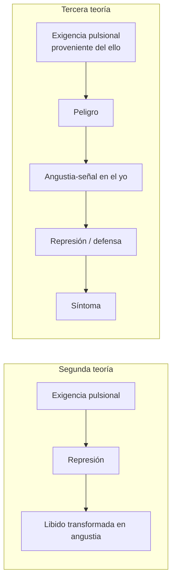
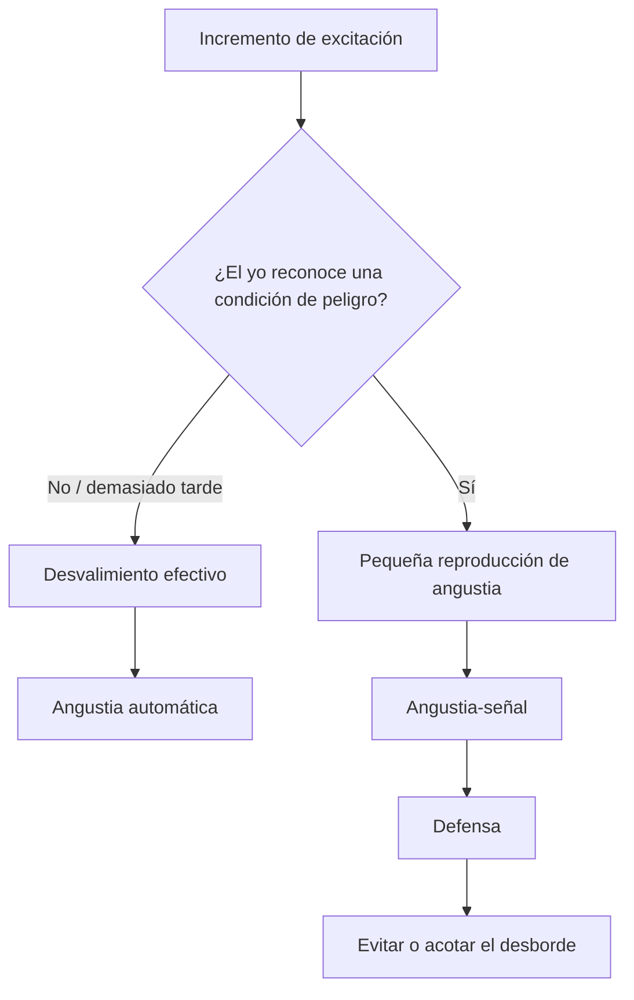
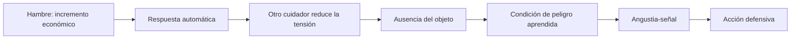
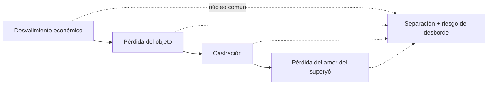
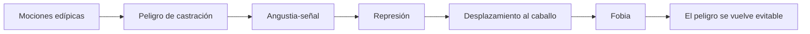

# Tercera teoría de la angustia

## El giro en una imagen

> **Tesis del capítulo.** En la tercera teoría, la angustia deja de ser solamente un producto de la represión: el yo la reproduce como señal para anticipar una situación traumática y poner en marcha la defensa.

## El cambio de fórmula

En formulaciones anteriores, Freud concebía la angustia como resultado de una transformación: la excitación sexual no tramitada o la libido afectada por la represión se trasmudaba en angustia. En *Inhibición, síntoma y angustia* invierte la relación causal en el caso de las psiconeurosis: no es la represión la que crea la angustia; el yo produce angustia como señal ante un peligro y pone en marcha la defensa.

La fórmula didáctica es:

> Exigencia pulsional proveniente del ello → peligro → angustia-señal en el yo → defensa/represión → síntoma.

La inversión no borra todo lo anterior. La angustia continúa siendo un afecto displacentero con vías corporales de descarga. Lo nuevo es su función de señal y su lugar estructural en la constitución y defensa del yo.

## Peligro y situación traumática

El peligro es la expectativa de una situación de desvalimiento. La situación traumática es el desvalimiento efectivo ante un incremento de excitación que el aparato no puede ligar ni tramitar.

El núcleo genuino del peligro es económico: una cantidad de excitación amenaza con desbordar al aparato. Esta formulación enlaza la tercera teoría con *Más allá del principio de placer*, donde lo traumático es la irrupción de cantidades no ligadas después de romperse la protección antiestímulo.

## Angustia automática

La angustia automática es una reacción involuntaria cuando la situación traumática ya se produjo. El yo se encuentra avasallado por una magnitud que no domina. No funciona como prevención: testimonia el fracaso de las condiciones protectoras.

## Angustia-señal

La angustia-señal es una pequeña reproducción anticipada de la reacción de angustia. El yo asocia una condición perceptible con la posibilidad de quedar desvalido y produce la señal para movilizar la defensa antes del desborde.

No es simplemente “menos angustia”. Es un progreso en la organización psíquica: sustituye la irrupción automática por una expectativa que permite actuar.

| Angustia automática | Angustia-señal |
|---|---|
| la situación traumática está presente | se anticipa una situación de peligro |
| el aparato queda desbordado | el yo produce una pequeña cuota de angustia |
| cantidad no ligada | señal ligada a una condición reconocible |
| reacción pasiva | movilización defensiva |

## Nacimiento, desvalimiento y dependencia

El nacimiento ofrece el modelo corporal de la reacción de angustia: alteraciones respiratorias, cardíacas y motrices producidas frente a un peligro para la subsistencia. Según el énfasis de Seminarios, no debe decirse sin matices que el nacimiento es un trauma psíquicamente registrado: todavía no existe un aparato capaz de representarlo como pérdida.

Su importancia es arquetípica e histórica. El ser humano nace en desvalimiento biológico y depende de otro para sobrevivir. Esa dependencia transforma el desvalimiento físico en desvalimiento psíquico y hace de la ausencia del objeto una condición de peligro.

## De la ausencia a la pérdida

En un primer momento, el incremento de necesidad provoca automáticamente angustia. Más tarde, el lactante aprende que la presencia de la persona cuidadora evita ese incremento. La ausencia de la madre puede entonces operar como señal de una pérdida posible.

Esta asociación inaugura una función psíquica:

1. se reconoce una condición de peligro;
2. se reproduce una pequeña cuota de angustia;
3. la señal pone en marcha acciones defensivas;
4. se intenta evitar el desvalimiento traumático.

El avance no consiste en eliminar la angustia. Consiste en usar una pequeña reproducción del afecto como información y preparación.

## Serie de condiciones de peligro

Las condiciones cambian con el desarrollo, pero conservan el peligro de separación o pérdida:

- incremento de excitación frente al desvalimiento;
- pérdida del objeto protector;
- castración durante la fase fálica;
- pérdida del amor del superyó o angustia de la conciencia moral.

La castración adquiere un valor organizador porque permite representar otras pérdidas corporales y separaciones dentro de la serie fálica.

## Hans: del peligro al síntoma

En la fobia de Juanito, una moción hostil hacia el padre y una moción amorosa hacia la madre participan del conflicto edípico. La amenaza de castración constituye el peligro. El yo produce angustia-señal, reprime la moción y desplaza el peligro hacia el caballo.

El síntoma fóbico ofrece una ventaja defensiva: un peligro pulsional interno, del cual no se puede huir, es sustituido por un objeto exterior evitable. Pero el precio es la limitación de la vida del niño.

## Comparación de las tres versiones

| Versión | Fórmula central | Estatuto de la angustia | Articulación privilegiada |
|---|---|---|---|
| Primera | excitación sexual somática sin elaboración psíquica → angustia | descarga actual de una cantidad | neurosis actuales |
| Segunda | libido afectada por la represión → angustia | transformación del monto de afecto | psiconeurosis y represión |
| Tercera | peligro → angustia-señal → represión/defensa | afecto producido por el yo para anticipar el trauma | castración, desvalimiento y síntoma |

La tercera teoría conserva además la angustia automática para nombrar la reacción directa ante un desborde. Por eso no conviene reducir toda angustia a señal.

## Articulaciones que hay que poder desarrollar

- Angustia automática ↔ trauma y cantidades no ligadas en *Más allá*.
- Angustia-señal ↔ yo de la segunda tópica como instancia defensiva.
- Complejo de castración ↔ Edipo ↔ motor de la represión.
- Pérdida del objeto ↔ desvalimiento ↔ dependencia del otro de los primeros cuidados.
- Tercera teoría ↔ caso Hans y formación del síntoma fóbico.
