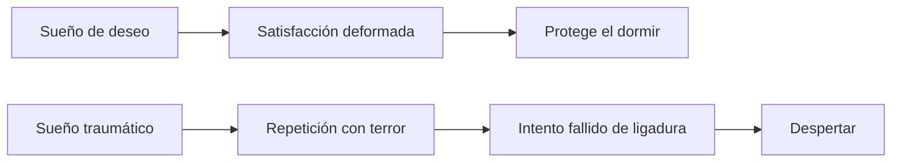
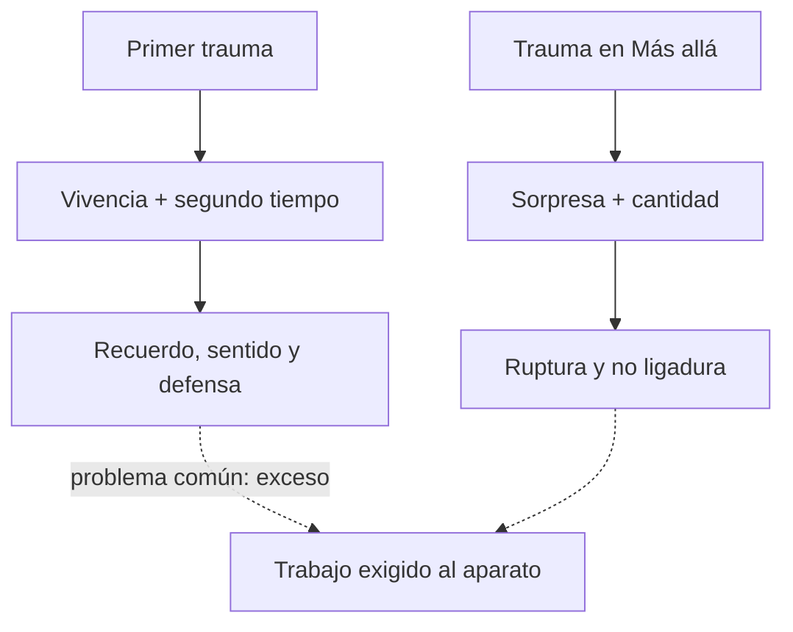
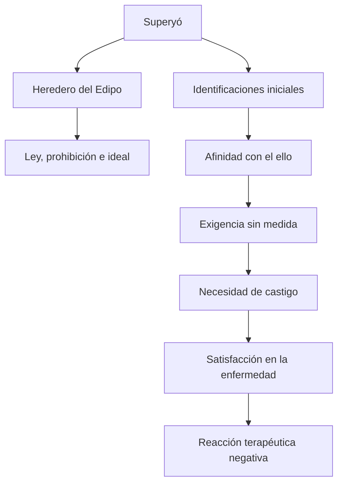

# Respuestas modelo

## Criterio

Una respuesta de desarrollo debería incluir:

1. definición precisa del problema;
2. ubicación del texto y momento teórico;
3. desarrollo argumental, no una mera enumeración;
4. diferencias conceptuales relevantes;
5. escena o referencia clínica cuando corresponda;
6. cierre que responda exactamente la consigna.

En una articulación conviene usar una estructura explícita: **punto de partida → límite o problema → reformulación → consecuencia**.

## Modelo 1 — contenido nuevo

### Consigna

¿Por qué Freud necesita postular un inconsciente no reprimido? Desarrolle sus consecuencias para la segunda tópica.

### Esquema

1. La primera tópica explica represión y retorno.
2. La resistencia no puede provenir de lo reprimido, que busca retornar.
3. Una parte del yo es inconsciente y resiste.
4. Se distingue inconsciente descriptivo, dinámico y estructural.
5. El ello formaliza lo inconsciente no reprimido.
6. Yo, ello y superyó permiten localizar nuevos obstáculos clínicos.

### Desarrollo

Freud formula la segunda tópica porque la distinción entre consciente, preconsciente e inconsciente ya no alcanza para explicar ciertos hechos clínicos. En la primera tópica, el inconsciente dinámico coincide con lo reprimido: representaciones apartadas de la conciencia por la defensa que, sin embargo, insisten en retornar mediante sueños, síntomas y transferencia. Pero durante el tratamiento Freud encuentra resistencias que operan inconscientemente y no pueden atribuirse a lo reprimido, pues lo reprimido procura expresarse. La resistencia debe partir del yo, aunque el paciente no tenga conciencia de ella.

Esto obliga a separar tres usos del término inconsciente. En sentido descriptivo, inconsciente es lo que no está actualmente en la conciencia y puede permanecer latente como preconsciente. En sentido dinámico, designa lo reprimido, mantenido fuera de la conciencia por una fuerza. El tercer inconsciente no es latente ni reprimido: es estructural. Freud lo formaliza como ello, sede pulsional y campo de procesos no ligados.

El yo se redefine entonces como una parte del ello alterada por el contacto con el mundo exterior. No es completamente consciente ni autónomo: hunde sus raíces en el ello, toma de allí su fuerza y puede resistir sin saberlo. El superyó es una diferenciación dentro del yo que conserva las identificaciones y prohibiciones edípicas, pero mantiene también una afinidad con el ello. Puede manifestarse como sentimiento inconsciente de culpa y necesidad de castigo.

La consecuencia clínica es que ya no todos los obstáculos se resuelven haciendo consciente una representación reprimida. Además de las resistencias yoicas, existen una resistencia del ello vinculada con la compulsión de repetición y una resistencia del superyó vinculada con la reacción terapéutica negativa. La segunda tópica no elimina la primera: la complementa para explicar procesos pulsionales y resistencias que el modelo de la represión no alcanzaba a localizar.

### Errores frecuentes

- afirmar que todo el ello es “lo reprimido”;
- decir que la segunda tópica reemplaza por completo a la primera;
- definir las tres instancias sin presentar el problema clínico que exige la reformulación;
- atribuir la resistencia a lo reprimido;
- confundir inconsciente descriptivo con inconsciente estructural.

## Modelo 2 — articulación con el segundo parcial

### Consigna

Compare el sueño como cumplimiento de deseo con los sueños de las neurosis traumáticas.

### Esquema

1. Función clásica: cumplimiento de deseo y guardián del dormir.
2. Trauma: sorpresa, terror y falta de preparación.
3. Repetición literal, displacentera y despertar.
4. No refuta toda la teoría del sueño: introduce una tarea previa.
5. Intento retroactivo de ligadura y preparación angustiada.

### Desarrollo

En *La interpretación de los sueños*, Freud sostiene que el sueño es un cumplimiento alucinatorio de deseo. Un deseo inconsciente infantil se enlaza con restos diurnos y, mediante condensación, desplazamiento y figurabilidad, encuentra una satisfacción deformada. Aunque el contenido manifiesto pueda ser displacentero para el yo, la formación conserva una satisfacción para el sistema inconsciente y protege el dormir.

Los sueños de las neurosis traumáticas plantean un problema distinto. Después de un acontecimiento sorpresivo vivido con terror, el soñante retorna una y otra vez a la escena traumática y despierta nuevamente aterrorizado. La repetición no ofrece una satisfacción reconocible ni preserva el dormir. Por eso obliga a Freud a limitar la hegemonía del principio del placer y la universalidad inmediata de la función de cumplimiento de deseo.

El factor decisivo es la falta de preparación. La sorpresa impide el apronte angustiado que habría reforzado la protección del aparato. Una magnitud de excitación perfora la protección antiestímulo e ingresa como cantidad no ligada. Antes de que el principio del placer pueda tramitarla, el aparato debe realizar una tarea más originaria: ligar esa excitación.

La repetición onírica intenta producir retroactivamente la preparación y la ligadura que faltaron en el momento del trauma. Es un intento que fracasa reiteradamente, de allí el despertar con terror. El sueño traumático no lleva a abandonar toda relación entre sueño y deseo; muestra una función previa y perturbada. Sólo después de ligar la cantidad sería posible restablecer el dominio del principio del placer y el trabajo onírico ordinario.

### Errores frecuentes

- decir que Freud abandona completamente la tesis del cumplimiento de deseo;
- explicar el sueño traumático sólo por su contenido penoso y no por su repetición;
- omitir sorpresa, terror y falta de apronte angustiado;
- afirmar que la repetición ya logró ligar el trauma;
- confundir angustia, miedo y terror.

## Modelo 3 — articulación con el primer parcial

### Consigna

Compare la concepción temprana del trauma con la concepción económica de *Más allá del principio de placer*.

### Esquema

1. Primera época: escena sexual, defensa y eficacia retroactiva del recuerdo.
2. Dos tiempos y articulación representacional.
3. *Más allá*: cantidad, sorpresa, ruptura y no ligadura.
4. Continuidad: un exceso exige trabajo al aparato.
5. Diferencia: recuerdo y sentido versus economía y ligadura.

### Desarrollo

En los primeros escritos sobre las neuropsicosis de defensa, Freud piensa el trauma en relación con una vivencia sexual prematura que el yo no puede tramitar. Su eficacia patógena no reside necesariamente en el primer acontecimiento aislado: un segundo tiempo, posterior a la pubertad, reactiva el recuerdo y le confiere retroactivamente un valor sexual y traumático. El conflicto se organiza en el campo de las representaciones, la defensa y el retorno de lo reprimido.

La caída de la teoría de la seducción obliga luego a dar mayor valor a la fantasía y a la realidad psíquica. Entre vivencia y síntoma no hay una causalidad material simple: intervienen fijaciones, fantasías y modos de satisfacción pulsional.

En *Más allá del principio de placer*, Freud formula el trauma en términos económicos. Una excitación sorpresiva perfora la protección antiestímulo e inunda el aparato con cantidades que no están ligadas a representaciones. El principio del placer queda momentáneamente abolido porque, antes de descargar o tramitar la excitación, el aparato debe dominarla y ligarla. La repetición traumática testimonia ese trabajo fallido o incompleto.

Ambas concepciones sitúan algo que excede los recursos disponibles del aparato y produce efectos posteriores. Pero no son equivalentes. En la concepción temprana predominan la escena, el recuerdo, la retroacción y la defensa; en 1920 predominan la cantidad, la sorpresa, la ruptura y la ligadura. La articulación muestra un desplazamiento desde “qué representación se volvió traumática y fue reprimida” hacia “qué magnitud no pudo ligarse para entrar en el campo de las representaciones”.

### Errores frecuentes

- reducir la primera teoría a un acontecimiento real de efecto inmediato;
- omitir el segundo tiempo y la eficacia del recuerdo;
- decir que en *Más allá* todo trauma carece definitivamente de representación;
- presentar las dos teorías como sinónimos;
- olvidar el papel posterior de la fantasía y la realidad psíquica.

## Modelo 4 — contenido nuevo

### Consigna

Explique la génesis del superyó en *El yo y el ello* y caracterice sus dos dimensiones. Articule su vertiente cruel con la necesidad inconsciente de castigo y la reacción terapéutica negativa.

### Esquema

1. Diferenciación del yo con raíces en el ello.
2. Sepultamiento del Edipo: investiduras de objeto sustituidas por identificaciones.
3. Padre muerto: ley, prohibición e ideal.
4. Identificaciones iniciales y padre vivo: cercanía al ello y exigencia sin medida.
5. Superyó sádico + yo masoquista.
6. Necesidad de castigo, satisfacción en la enfermedad y reacción terapéutica negativa.

### Desarrollo

En *El yo y el ello*, Freud caracteriza al superyó como una diferenciación del yo que conserva una estrecha relación con el ello. Su génesis presenta dos vertientes. Por una parte, es heredero del complejo de Edipo: las investiduras de los objetos parentales abandonados son sustituidas por identificaciones. Esta vertiente, relacionada por la cátedra con el padre muerto, inscribe la ley, la prohibición y el ideal.

Por otra parte, el superyó se funda en identificaciones iniciales de la prehistoria personal, producidas cuando el yo todavía era endeble y anteriores a las elecciones de objeto plenamente constituidas. Esta vertiente, asociada con el padre vivo, conserva mayor afinidad con el ello y puede exigir una satisfacción pulsional total y sin medida.

En articulación con la pulsión de muerte, el superyó puede volverse hipermoral y cruel: ocupa una posición sádica frente a un yo masoquista. De allí provienen la necesidad inconsciente de castigo y la satisfacción en el padecimiento. La enfermedad adquiere entonces un valor para el paciente y, cuando el tratamiento amenaza con quitarle esa satisfacción, puede empeorar al mejorar: es la reacción terapéutica negativa. El paciente no se siente conscientemente culpable, sino enfermo.

### Fórmula de memoria

> Edipo → identificaciones → ley. Identificaciones iniciales → cercanía al ello → exigencia sin medida. Superyó cruel + yo masoquista → castigo → enfermedad → reacción terapéutica negativa.

### Errores frecuentes

- afirmar que el superyó es simplemente una parte del ello;
- sostener que se funda en la culpa consciente, en vez de entender la culpa como uno de sus efectos;
- presentar sus dos vertientes como dos superyós separados;
- olvidar la posición masoquista del yo al explicar la necesidad de castigo;
- interpretar la reacción terapéutica negativa como una decisión consciente de sabotear la cura.
